# HustleHub+

**A secure freelance marketplace.**

- **Module:** INSY7314, Information Systems 3D
- **Part:** 2, Secure Stack (in progress, due 12 October 2026)
- **Part 1 video:** [Watch here](https://youtu.be/dxhXuTjIDsg)
- **Part 2 video:** To do

> **Part 2 status.** The API is complete and all its tests pass. The React client
> has its base set-up only. The pages, the frontend tests, the screenshots and the
> video are still to do. [Section 11](#11-part-2-work-still-to-do) lists each open item.

---

## Contents

1. [About HustleHub+](#1-about-hustlehub)
2. [Tech stack](#2-tech-stack)
3. [Team](#3-team)
4. [System architecture](#4-system-architecture)
5. [Data model and roles](#5-data-model-and-roles)
6. [Security](#6-security)
7. [Getting started](#7-getting-started)
8. [API reference](#8-api-reference)
9. [Testing](#9-testing)
10. [Known limits](#10-known-limits)
11. [Part 2 work still to do](#11-part-2-work-still-to-do)
12. [Coming in Part 3](#12-coming-in-part-3)
13. [Demonstration](#13-demonstration)
14. [References](#14-references)

---

## 1. About HustleHub+

HustleHub+ is a marketplace for freelance services. A Freelancer lists a
service, called a **gig**. A Client finds a gig and books it. Each booking
records a simulated payment, called a **transaction**. The Freelancer sees the
income from these transactions.

The system keeps passwords, tokens and payment records. For this reason, the
team designed security into each layer from the start.

### 1.1 The roles

Each account has one role. The API reads the role from the database on each
request and uses it to decide what the user can do. This is role based access
control: a role holds the permissions, and a user gets a role (National
Institute of Standards and Technology, 2026; OWASP, n.d. b).

| Role | Who | What the role can do |
|---|---|---|
| **Client** | A person who needs work done | Browse gigs, book a gig, see their own bookings and payments |
| **Freelancer** | A person who sells a service | Create and manage their own gigs, see bookings of their gigs, see their income |
| **Admin** | The platform operator | See all records, remove any gig, list users, change the role of another user |

**A user cannot make themselves an Admin.** Registration accepts only `Client`
and `Freelancer`. The first Admin comes from `npm run seed:admin`, which needs
access to the server files and the database. A request over the network cannot
run it.

### 1.2 What Part 2 adds

Part 1 built the secure base: registration, login, bcrypt, JWT, HTTPS and
validation. Part 2 adds the marketplace and the controls around it.

| Area | Part 2 work | Status |
|---|---|---|
| Gigs | A Freelancer creates, reads, updates and deletes their own gigs | **Done** |
| Bookings | A Client books a gig. The server calculates the price | **Done** |
| Transactions | Each booking creates one payment record that nobody can change | **Done** |
| Income | A Freelancer sees total income and income for each month | **Done** |
| Access control | Role checks on each write route, and ownership checks inside each query | **Done** |
| Sanitisation | Operator keys refused, HTML stripped from free text | **Done** |
| Rate limits | Global, login, registration and booking limits | **Done** |
| Security headers | Helmet with a strict Content Security Policy (CSP) | **Done** |
| CORS | An allowlist of browser origins | **Done** |
| API documentation | An OpenAPI 3.1 document and a Scalar page at `/docs` | **Done** |
| API tests | 81 unit tests and 1,323 Postman assertions, all pass | **Done** |
| React client | Base set-up: Vite, React Router, Tailwind CSS, shadcn/ui, an API helper | **Done** |
| React client | Pages for login, register, gigs, bookings, transactions and income | To do |
| Frontend tests | Component and interaction tests, and a coverage report | To do |
| Evidence | Screenshots and the demonstration video | To do |

---

## 2. Tech stack

HustleHub+ uses the **MERN** stack: MongoDB, Express, React and Node.js. One
language, JavaScript, runs in the database queries, the server and the browser
(MongoDB, Inc., n.d.; Ishaq et al., 2023).

| Tier | Technology | Version | Job in the system |
|---|---|---|---|
| **(M)** Database | MongoDB | 6+ (tested on 9) | Stores users, gigs, bookings and transactions |
| **(E)** Framework | Express | 5.3 | Routes, middleware and the error handler (OpenJS Foundation, n.d. h, n.d. j) |
| **(R)** Frontend | React | 19 | The browser client (in progress) |
| **(N)** Runtime | Node.js | 22+ (tested on 26) | Runs the API as one HTTPS process (OpenJS Foundation, n.d. a) |

### 2.1 API packages

| Package | Version | Why the API uses it |
|---|---|---|
| `mongoose` | 9.11 | Schemas, a second validation layer and the bcrypt hook (Automattic, n.d. e) |
| `bcryptjs` | 3.0 | Password hashing (Wirtz, n.d.) |
| `jsonwebtoken` | 9.0 | Signs and verifies the token (Auth0, n.d.) |
| `helmet` | 8.3 | Sets the security headers and the CSP (Hahn, n.d.) |
| `cors` | 2.8 | Applies the browser origin allowlist (OpenJS Foundation, n.d. b) |
| `express-rate-limit` | 8.7 | Rate limits on each sensitive route (Friedly, n.d.) |
| `sanitize-html` | 2.18 | Removes HTML from free text (Apostrophe Technologies, n.d.) |
| `dotenv` | 18.0 | Reads configuration from `.env` (Motte, n.d.) |

| Development tool | Version | Why the team uses it |
|---|---|---|
| `jest` | 30 | Unit tests for the API (OpenJS Foundation, n.d. e) |
| `newman` | 6.2 | Runs the Postman collection from the command line (Postman, Inc., n.d. b) |
| `newman-reporter-htmlextra` | 1.23 | Writes the HTML test report |
| `@scalar/express-api-reference` | 0.10 | Builds the API documentation page (Scalar, n.d.) |
| `@scalar/api-reference` | 1.73 | Holds the browser script that the documentation page loads |
| `selfsigned` | 5.5 | Makes the local TLS certificate without `openssl` (Romaniello, n.d.) |
| `eslint` | 10 | Checks code style. `eqeqeq` and `curly` are errors |

### 2.2 Client packages

| Package | Version | Why the client uses it |
|---|---|---|
| `react`, `react-dom` | 19.3 | The user interface (Meta Platforms, Inc., n.d.) |
| `react-router-dom` | 7.18 | Page routes (Shopify, Inc., n.d.) |
| `vite` | 8.3 | The HTTPS development server, the `/api` proxy and the build (Vite Team, n.d.) |
| `tailwindcss` | 4.3 | Styles |
| shadcn/ui (radix-nova) | 4 | Accessible components that the project owns (shadcn, n.d.) |
| `vitest` | 5.0 | The frontend test runner (Vitest Team, n.d.) |
| `@testing-library/react` | 16.3 | Tests that use the page as a person does (Testing Library, n.d.) |

---

## 3. Team

| Member | Student number |
|---|---|
| Tyreece Sewbaran | *ST10439074* |
| Dylan Olsen | *ST10440133* |
| Ethan Edwards | *ST10442420* |
| Ndumsio Jwara | *ST10440124* |

---

## 4. System architecture

### 4.1 Architecture diagram

The diagram shows the tiers, the two trust boundaries and the position of each
security control. A dashed box is Part 2 work that is still to do.

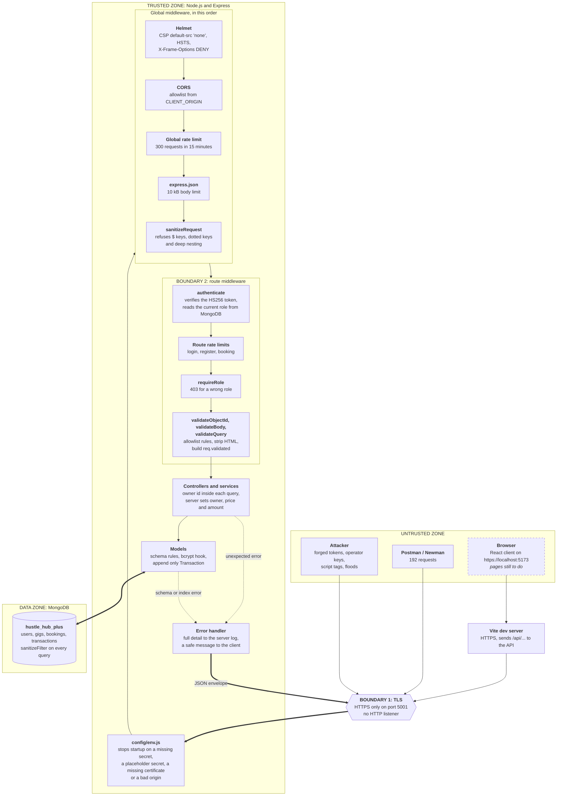

A request enters only through TLS, at **Boundary 1**. The global middleware then
checks it before any route sees it. At **Boundary 2**, a protected route checks
the token, the rate limit, the role and the input, in that order. Only a
request that passes each check reaches a controller. Each check that fails
answers at once, in the same JSON envelope from `utils/respond.js`. An
unexpected error goes to one error handler, which logs the detail and sends a
safe message.

### 4.2 Folder structure

```
INSY7314-POE/
|
+-- api/                         The Express API
|   +-- server.js                Connects to MongoDB, builds indexes, starts HTTPS
|   +-- app.js                   Global middleware, route table, error handlers
|   +-- config/env.js            Checks .env and the certificate at startup
|   +-- routes/                  One router for each resource, and index.js as the table
|   +-- middleware/              authenticate, authorize, validation, sanitiser,
|   |                            rate limits, security headers, docs policy, errors
|   +-- controllers/             One function for each request
|   +-- services/                Booking and income logic
|   +-- models/                  User, Gig, Booking, Transaction
|   +-- utils/                   Response envelope, tokens, validators, owner scope
|   +-- openapi/                 The OpenAPI document that /docs shows
|   +-- __tests__/               Jest unit tests
|   +-- postman/                 The collection, the environment, reports/ (not committed)
|   +-- scripts/                 certs, seed:admin, db:reset, test:api
|   +-- screenshots/             Part 1 screenshots
|   +-- .env.example             Every setting with a safe value (committed)
|   +-- .env, certs/             Secrets and the TLS key                NOT COMMITTED
|
+-- client/                      The React client (Vite)
|   +-- src/services/api.js      The apiRequest helper and the token in sessionStorage
|   +-- src/pages/               Pages (home page only at this time)
|   +-- src/components/ui/       shadcn/ui components
|   +-- src/__tests__/           Vitest and React Testing Library tests
|   +-- vite.config.js           HTTPS, the /api proxy and the test set-up
|
+-- package.json                 Scripts that run both apps from the root
+-- references.md                Every source link in the code
```

Each folder has one job. A change to validation, storage or transport touches
one folder only. This follows the modularity rule of Parnas (1972). The API
uses REST resources: a URL names a resource and an HTTP method acts on it
(Fielding, 2000).

| Layer | Job | Does **not** |
|---|---|---|
| `config/` | Check the settings at startup | Hold a secret |
| `app.js` | Put the middleware in order and mount the routers | Hold business logic |
| `routes/` | Name the middleware chain for each URL | Touch the database |
| `middleware/` | Authenticate, authorise, validate, sanitise, limit | Know about one resource |
| `controllers/` | Handle one request | Read `req.body` or build JSON by hand |
| `services/` | Booking and income rules that need more than one model | Know that HTTP exists |
| `models/` | Schemas, indexes, hooks | Know that HTTP exists |
| `utils/` | Shared helpers | Keep request state |

### 4.3 Request flow: a booking

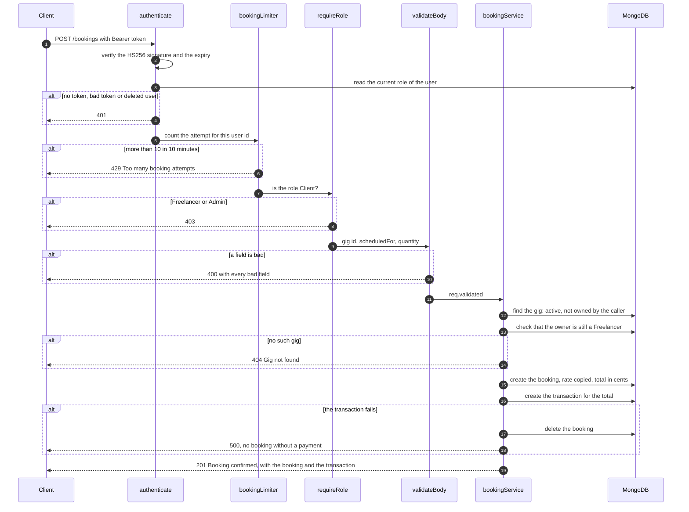

**401 means that the API does not know who you are. 403 means that the API
knows who you are, and the answer is still no.** HTTP gives these two codes
these meanings (Fielding, Nottingham and Reschke, 2022).

---

## 5. Data model and roles

### 5.1 Data model

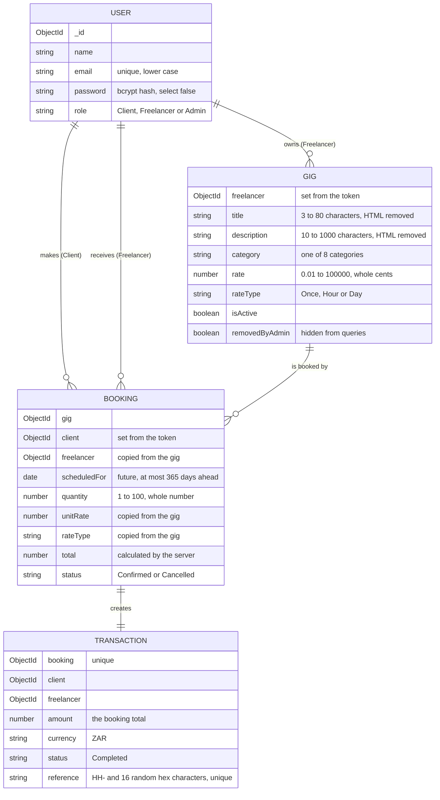

The gig categories are `HouseCleaning`, `DogGrooming`, `Gardening`, `Tutoring`,
`Plumbing`, `Electrical`, `Moving` and `Photography`.

**Why a booking copies the rate.** A booking is a financial record. It must show
the price on the day of the booking. If the Freelancer changes the gig rate
later, the old booking does not change.

**Indexes.** Each list query has an index, so the database does not scan the
full collection. Some indexes also enforce a rule:

| Collection | Index | Purpose |
|---|---|---|
| users | `email`, unique | One account for each email |
| gigs | `isActive, category, createdAt` | The browse list |
| gigs | `freelancer, createdAt` | The "my gigs" list |
| bookings | `client, createdAt` and `freelancer, createdAt` | The booking lists |
| bookings | `gig` | The check for bookings before a gig delete |
| bookings | `client, gig, scheduledFor`, unique for `Confirmed` only | Stops a double booking when a client sends the same request again (MongoDB, Inc., 2026a) |
| transactions | `booking`, unique | One transaction for each booking |
| transactions | `reference`, unique | One reference for each transaction |
| transactions | `freelancer, createdAt` and `client, createdAt` | The lists and the income total |

The server builds every index before it accepts the first request.

### 5.2 Access rules (RBAC matrix)

"Own" means that the record belongs to the caller. For a record of another
user, the API answers **404**, not 403. A 403 would tell an attacker that the
record exists (OWASP, 2023a).

| Action | Route | Client | Freelancer | Admin |
|---|---|:---:|:---:|:---:|
| Register | `POST /auth/register` | Public | Public | Seed script only |
| Log in | `POST /auth/login` | Public | Public | Public |
| Read own profile | `GET /auth/me` | Yes | Yes | Yes |
| Browse active gigs | `GET /gigs` | Yes | Yes | Yes |
| Read one gig | `GET /gigs/:id` | Active only | Active, or own | Yes, also inactive |
| List own gigs | `GET /gigs/mine` | 403 | Own | 403 |
| Create a gig | `POST /gigs` | 403 | Yes | 403 |
| Update a gig | `PUT /gigs/:id` | 403 | Own | 403 |
| Delete a gig | `DELETE /gigs/:id` | 403 | Own | Any |
| Book a gig | `POST /bookings` | Yes, not own gig | 403 | 403 |
| List bookings | `GET /bookings` | Own | Of own gigs | All |
| Read one booking | `GET /bookings/:id` | Own | Of own gigs | Yes |
| List transactions | `GET /transactions` | Own | Of own gigs | All |
| Read one transaction | `GET /transactions/:id` | Own | Of own gigs | Yes |
| Read income | `GET /income/me` | 403 | Own | 403 |
| List users | `GET /users` | 403 | 403 | Yes |
| Change a role | `PATCH /users/:id/role` | 403 | 403 | Yes, not own |
| Change or delete a booking or a transaction | No route | 404 | 404 | 404 |

---

## 6. Security

This section tells what each control does, why the team chose it, and what
goes wrong without it. Code in this repository enforces each control. A test
proves each control. The controls follow the OWASP Top 10 (OWASP, 2021a, 2021b,
2021c, 2021d, 2021e) and the OWASP API Security Top 10 (OWASP, 2023a, 2023b,
2023c, 2023d).

### 6.1 Password hashing

**bcrypt with a cost of 12, in a Mongoose pre-save hook.**

```js
// models/User.js
const SALT_ROUNDS = 12

userSchema.pre('save', async function () {
    if (!this.isModified('password')) {
        return
    }

    this.password = await bcrypt.hash(this.password, SALT_ROUNDS)
})
```

- **Hash, not encryption.** A hash is one way. A stolen database gives no
  passwords. Login uses `bcrypt.compare`, which hashes the attempt with the
  stored salt (Grassi et al., 2017; OWASP, n.d. k).
- **bcrypt, not SHA-256.** A fast hash lets an attacker try billions of
  guesses each second. bcrypt is slow on purpose. The cost is in the hash, so
  the team can increase it later (Provos and Mazières, 1999).
- **Cost 12.** Cost 12 means 4,096 rounds. A login takes about a quarter of a
  second, but each guess costs an attacker the same time (OWASP, n.d. k).
- **A hook, not the controller.** The hook runs on each save, from each code
  path (Automattic, n.d. a). No path can store a plain text password.
- **Validation first.** Mongoose validates before the hook runs. The password
  rule checks the plain text, before the hash replaces it.
- **8 to 72 characters.** bcrypt ignores bytes after 72, so the API refuses a
  longer password (Wirtz, n.d.). A password needs an uppercase letter, a
  lowercase letter, a number and a symbol. The API does not trim a password.

Three barriers keep the hash inside the server:

| Barrier | How | What it stops |
|---|---|---|
| Query | `select: false` on the field (Automattic, n.d. d) | A normal `find()` returns no hash |
| Opt in | Login asks for `.select('+password')` | Each read of the hash is on purpose |
| Output | `toJSON` deletes `password` | A document with the hash still cannot go to a client |

### 6.2 Tokens and authentication

**An HS256 JSON Web Token (JWT) that holds the user id and the role.**

A JWT has a header, a payload and a signature (Jones, Bradley and Sakimura,
2015). The client sends it in the `Authorization` header as `Bearer <token>`
(Jones and Hardt, 2012).

```js
// utils/token.js, shortened
jwt.sign({ id, role }, process.env.JWT_SECRET, { algorithm: 'HS256', expiresIn: process.env.JWT_EXPIRES_IN });
jwt.verify(token, process.env.JWT_SECRET, { algorithms: ['HS256'] });
```

- **The signature stops a forged token.** Anyone can read the payload, but a
  change to the payload breaks the signature. Only the server has the secret.
  The Postman test "A forged Admin token is refused" proves this.
- **The algorithm is fixed to HS256.** The verifier refuses a token that names a
  different algorithm, such as `none` or `HS512` (Sheffer, Hardt and Jones,
  2020; OWASP, n.d. h). A Jest test proves this.
- **The token expires.** `.env.example` sets a life of 1 hour (`JWT_EXPIRES_IN`). The
  token is stateless, so expiry limits the damage from a stolen token.
- **The secret is safe.** `JWT_SECRET` comes from `.env`, which git ignores. The
  API does not start if the secret is missing or is the `GENERATE_ME`
  placeholder (Wiggins, 2017; MITRE, 2026h).

**New in Part 2: the role comes from the database.** In Part 1, the role came
from the token. A demoted Admin kept their power until the token expired. Now
`authenticate` reads the current role from MongoDB on each request:

```js
// middleware/authenticate.js
const user = await User.findById(payload.id).select('role').lean();

if (!user) {
    return fail(res, 401, 'Invalid token');
}

req.user = { id: payload.id, role: user.role };
```

- A role change applies on the next request of that user.
- A deleted user gets 401 at once.
- The API refuses a token whose `id` is not a 24 character hex string, before
  any query runs. A signed payload cannot carry a query operator.

The Postman folder "Current user and role changes" proves this. The Admin
demotes Ethan to Client. Ethan's old token then gets 403 on `/income/me`. After
the Admin restores the role, the same token works again.

**Each resource router, except `/auth`, starts with one line:**

```js
router.use(authenticate);
```

A route that a developer adds later is protected by default (OWASP, n.d. b).
The `/users` router also applies `requireRole('Admin')` in the same way. The
`/auth` router has public routes, so it adds `authenticate` to `/auth/me` only.
Of the API routes, only `GET /health`, `POST /auth/register` and
`POST /auth/login` are public. A Jest test checks that the OpenAPI document
marks only these three as public.

### 6.3 Access control and ownership

Broken access control is the first risk in the OWASP Top 10 (OWASP, 2021a). The
API checks access at two levels.

**Level 1: the role.** `requireRole` stops a role that can never do the action,
with 403 (OWASP, 2023d).

```js
router.post('/', requireRole('Freelancer'), validateBody(GIG_RULES), gigController.createGig);
router.delete('/:id', requireRole('Freelancer', 'Admin'), validateObjectId, gigController.deleteGig);
```

**Level 2: the owner, inside the query.** The owner id is part of the database
filter. A record of another user does not match, so the API answers 404
(OWASP, 2023a; MITRE, 2026f).

```js
// controllers/gigController.js: a Freelancer updates only their own gig
Gig.findOneAndUpdate(
    { _id: req.params.id, freelancer: req.user.id, removedByAdmin: mongoose.trusted({ $ne: true }) },
    req.validated,
    { returnDocument: 'after', runValidators: true }
);

// utils/ownerScope.js: a Client sees their side, a Freelancer sees their side
{ $or: [{ client: user.id }, { freelancer: user.id }] }
```

A check after the query would read the record first. A check inside the query
never loads a record that the caller cannot see.

**The server sets each sensitive value.** A request body cannot set an owner, a
price or an amount (OWASP, 2023b; OWASP, n.d. j):

| Value | Where it comes from |
|---|---|
| `gig.freelancer` | The token |
| `booking.client` | The token |
| `booking.freelancer` | The gig |
| `booking.unitRate`, `booking.rateType` | The gig |
| `booking.total` | `computeTotal(rate, quantity)`, in whole cents |
| `transaction.amount` | The booking total |
| `transaction.reference` | `crypto.randomBytes` |

The Postman test "An owner id in the body is ignored" proves this.

**Other business rules:**

- A Client cannot book their own gig, an inactive gig, or a gig whose owner is
  no longer a Freelancer.
- A gig with bookings is made inactive, not deleted, because its bookings and
  transactions point to it.
- When the Admin removes a booked gig, the owner cannot turn it on again.
- An Admin cannot change their own role, so the platform always keeps an Admin.

### 6.4 Input validation

**Allowlist rules in middleware, before each controller.**

Each route has a rule table. The middleware checks each field, then builds
`req.validated` from the table only. Controllers read `req.validated`, never
`req.body` (OWASP, n.d. g; MITRE, 2026a).

```js
// utils/validators.js
export const BOOKING_RULES = {
    gig: { field: 'gig', label: 'Gig', type: 'objectId' },
    scheduledFor: { field: 'scheduledFor', label: 'Scheduled date', type: 'date', future: true, maxDaysAhead: 365 },
    quantity: { field: 'quantity', label: 'Quantity', type: 'number', min: 1, max: MAX_QUANTITY, integer: true, required: false },
};
```

| Checker | What it refuses |
|---|---|
| `checkString` | A value that is not a string, such as `{ "$ne": null }`. A value outside the allowed list, the length or the pattern |
| `checkNumber` | A string such as `"250"`, an object, a value outside the range, a fraction for a whole number, more than 2 decimals for money |
| `checkDate` | A value that is not a date, a past date, a date more than 365 days ahead |
| `checkObjectId` | A value that is not 24 hex characters |
| `checkBoolean` | The string `"false"`, because a non-empty string counts as true |

- **The type check stops operator injection.** MongoDB queries are objects.
  The payload `{ "email": { "$ne": null } }` matches any user. The API refuses
  each value that is not the expected type (MongoDB, Inc., 2026b; MITRE, 2026j).
- **Undeclared fields are dropped.** A field such as `"role": "Admin"` on a gig
  never reaches the database. This stops mass assignment (OWASP, 2023b; MITRE, 2026i).
- **The API reports every bad field at once.** The client can show all errors
  together.
- **Each `:id` is checked first.** `validateObjectId` accepts exactly 24 hex
  characters and answers 400 before any query. `mongoose.isValidObjectId`
  also accepts any 12 character string, so the API does not use it.
- **The query string is checked too.** `GET /gigs` accepts only a known
  `category` and a `search` of 50 characters or fewer. The search text is
  escaped before it becomes a pattern, so `.*(` is plain text.
- **The Mongoose schema is a second layer.** It enforces `required`, `enum`,
  `min`, `max` and `match`. Updates use `runValidators: true` (Automattic, n.d. f).
- **The body limit is 10 kB.** A larger body gets 413 (OpenJS Foundation, n.d. d).

```json
{
  "success": false,
  "message": "Validation failed",
  "errors": [
    { "field": "scheduledFor", "message": "Scheduled date must be in the future" },
    { "field": "quantity", "message": "Quantity must be a whole number" }
  ]
}
```

### 6.5 Sanitisation

Validation decides if a value has the right shape. Sanitisation stops values
that try to change a query or a page. The API has four layers.

**Layer 1: refuse dangerous keys.** `sanitizeRequest` runs on each request
before the routes. It walks the body and the query string. It refuses a key that
starts with `$`, a key that contains a `.`, and a bracket key such as
`category[$ne]`. It answers 400 and names each bad key. It does not remove the
key and continue, because a silent change hides the attack (OWASP, n.d. g).

```json
{
  "success": false,
  "message": "Request contains a forbidden key",
  "errors": [{ "field": "body.$where", "message": "This key is not allowed" }]
}
```

It also refuses a body nested more than 20 levels deep, so a crafted body cannot
use all the stack.

**Layer 2: Mongoose `sanitizeFilter`.** `server.js` turns on
`mongoose.set('sanitizeFilter', true)`. Mongoose then wraps each operator
object that reaches a query filter in `$eq`, so the operator becomes a plain
value (Automattic, n.d. b). The server marks its own operators with
`mongoose.trusted()`.

**Layer 3: strip HTML from free text.** The gig title and description are free
text. `sanitize-html` removes every tag and attribute (Apostrophe
Technologies, n.d.). The API strips again after it decodes `&lt;` and `&gt;`, so
encoded markup cannot become a live tag. It stops after 4 rounds and refuses
the text if it still changes. The length rules apply to the stripped text.

| Input title | Result |
|---|---|
| `<b>Deep</b> clean` | Stored as `Deep clean` |
| `Fix taps & pipes <2h` | Stored as typed |
| `&lt;script&gt;alert(1)&lt;/script&gt;Clean` | Stored as `Clean` |
| `<script>alert(1)</script>` | 400, because nothing is left |

**Layer 4: allowlist patterns.** A name accepts only letters, spaces, hyphens
and apostrophes. A script tag in a name gets 400. Stored script is the base of
stored cross-site scripting (Mozilla, n.d. c; MITRE, 2026b; OWASP, n.d. d). The
patterns are short and anchored, so they cannot cause a slow regular
expression (OWASP, n.d. l).

React also escapes text when it renders, so the client adds one more layer.

### 6.6 Rate limiting

**`express-rate-limit` on every route, with stricter limits on login,
registration and booking.**

Without a limit, an attacker can guess passwords, create many accounts or fill
the database with bookings (OWASP, 2023c; MITRE, 2026g).

| Limiter | Routes | Key | Default | Counts |
|---|---|---|---|---|
| Global | All, also preflight | IP address | 300 in 15 minutes | Every request |
| Login, per account | `POST /auth/login` | IP address and email | 5 in 15 minutes | Failed logins only |
| Login, per IP | `POST /auth/login` | IP address | 20 in 15 minutes | Failed logins only |
| Registration | `POST /auth/register` | IP address | 20 in 60 minutes | Every attempt |
| Booking | `POST /bookings` | User id | 10 in 10 minutes | Every attempt |

- **Two login limits.** The per account limit stops a guess attack on one
  account. The per IP limit stops password spraying, where an attacker tries
  one password on many accounts (OWASP, n.d. a).
- **A good login does not count.** `skipSuccessfulRequests` means that a user
  who types the right password is not locked out.
- **The key includes the email.** One attacker on a shared IP address cannot
  lock every user out.
- **The booking key is the user id.** One account cannot spread spam across IP
  addresses.
- **A clear 429.** Each limit answers in the standard envelope, for example
  `Too many login attempts. Try again in 15 minutes.` The `RateLimit` and
  `RateLimit-Policy` headers tell the client the limit (Friedly, n.d.).
- **Each limit is a setting.** The `RATE_LIMIT_*` values in `.env` change a
  limit without a code change. The API refuses a value that is not a positive
  whole number.

The Postman folder "Rate limits" proves each limit. It runs last, so the
blocked state does not change other tests.

### 6.7 Security headers and the Content Security Policy

**Helmet sets the headers on every response. The CSP allows nothing, because
the API sends JSON only.**

```js
// middleware/securityHeaders.js
helmet({
    contentSecurityPolicy: {
        useDefaults: false,
        directives: {
            defaultSrc: ["'none'"],
            frameAncestors: ["'none'"],
            baseUri: ["'none'"],
            formAction: ["'none'"],
        },
    },
    xFrameOptions: { action: 'deny' },
    crossOriginResourcePolicy: { policy: 'same-site' },
    strictTransportSecurity: true,
});
```

| Header | Value | What it stops |
|---|---|---|
| `Content-Security-Policy` | `default-src 'none';frame-ancestors 'none';base-uri 'none';form-action 'none'` | A response that runs a script, loads a file or shows in a frame (Mozilla, n.d. a) |
| `Strict-Transport-Security` | `max-age=31536000; includeSubDomains` | A browser that goes back to HTTP (Hodges, Jackson and Barth, 2012; Mozilla, n.d. d) |
| `X-Frame-Options` | `DENY` | Clickjacking in an old browser |
| `X-Content-Type-Options` | `nosniff` | A browser that guesses a JSON response is a script |
| `Cross-Origin-Resource-Policy` | `same-site` | Another site that embeds a response |
| `Cross-Origin-Opener-Policy` | `same-origin` | Another window that keeps a link to the page |
| `Referrer-Policy` | `no-referrer` | A URL that leaks to another site |
| `X-Powered-By` | Not sent | A free hint about the framework |

The team removed the Helmet default CSP, because it allows scripts and styles
from the same origin. A JSON API needs neither (Hahn, n.d.; OWASP, n.d. f). A
collection level Postman test checks the CSP, `X-Content-Type-Options`,
`X-Frame-Options` and `X-Powered-By` on all 192 responses.

**The one exception is the `/docs` page.** The page must run a script, so it
gets its own policy:

```
default-src 'none';script-src 'nonce-<random>';style-src 'self' 'unsafe-inline';img-src 'self' data:;
connect-src 'self';base-uri 'none';form-action 'none';frame-ancestors 'none'
```

The real header is one line. It is on two lines here so that it fits the page.

- The server makes a new random nonce for each page. A script runs only if it
  has this nonce (Mozilla, n.d. a; OWASP, n.d. c).
- The Scalar script comes from `node_modules`, not from a CDN.
- `connect-src 'self'` lets the page call this API only. The page turns off the
  Scalar telemetry, fonts, AI agent and MCP features.
- Scalar adds some `<style>` tags and style attributes with no nonce, so the
  policy allows inline styles. Styles cannot run code. `img-src` and the
  `'none'` default for fonts stop CSS from sending data to another host.
- The page is off when `NODE_ENV=production` (OpenJS Foundation, n.d. g).
- The Scalar packages are development tools. If an install leaves them out,
  the API starts without the page and logs one warning.

**The client CSP is still to do.** The production build needs its own policy.
See [section 11](#11-part-2-work-still-to-do).

### 6.8 CORS

**Only the origins in `CLIENT_ORIGIN` get permission to read a response.**

A browser blocks a page on one origin from reading a response from another
origin, unless the server allows it (Mozilla, n.d. b).

- The default allowlist is `https://localhost:5173`, the Vite server.
- The match is exact. `https://localhost:5173.evil.test` does not match.
- At startup, the API refuses an origin that is not `https`. It also refuses an
  origin with a path or a trailing slash, because such a value never matches.
- `credentials: false`. The token goes in a header, not a cookie, so the API
  needs no cookies.
- A request with no `Origin` header, such as Postman or `curl`, is not a browser
  request, so CORS does not apply to it. It still needs a token.

In development, the browser calls `/api/...` on the Vite server, and Vite sends
the call to the API (Vite Team, n.d.). The browser then sees one origin and one
certificate.

### 6.9 HTTPS

**HTTPS only. There is no HTTP listener.**

Each login carries a password, and each later request carries a token. Over
plain HTTP, any device on the path can read both (OWASP, 2021b). TLS encrypts
the traffic, detects changes and proves the server identity (Rescorla, 2018;
Mozilla, n.d. e).

- The API opens one HTTPS socket and no HTTP socket (OpenJS Foundation, n.d. f).
- The Vite server uses the same certificate, so the client is HTTPS too.
- `npm run certs` makes a self signed certificate for `localhost` and
  `127.0.0.1`. A browser warns about it, because no authority signed it. The
  traffic is still encrypted (OpenJS Foundation, n.d. i).
- The private key is in `certs/`, which git ignores.

### 6.10 Error handling

**Full detail goes to the server log. A safe message goes to the client.**

A stack trace shows file paths, module names and query shapes. This helps an
attacker (MITRE, 2026d; OWASP, 2021d). Without its own handler, Express can send
the stack trace as an HTML page (OpenJS Foundation, n.d. c). The API sends no stack trace, path or
driver error (OWASP, n.d. e).

| Error | Status | Message |
|---|---|---|
| Field validation | 400 | `Validation failed`, with `errors` |
| Bad `:id` | 400 | `Invalid id` |
| Markup that does not strip clean | 400 | `Title contains markup that cannot be stored` |
| Admin changes own role | 400 | `You cannot change your own role` |
| Forbidden key | 400 | `Request contains a forbidden key` |
| Deep nesting | 400 | `Request is nested too deeply` |
| Bad JSON | 400 | `Request body is not valid JSON` |
| Other unreadable body, such as a bad charset | 4xx from the parser | `Request body could not be read` |
| Missing or bad token | 401 | `Authentication required`, `Invalid token` or `Token has expired` |
| Wrong role | 403 | `You do not have permission to perform this action` |
| No record, or another user's record | 404 | `Gig not found`, `Booking not found` and so on |
| No route | 404 | `Route not found` |
| Duplicate email | 409 | `An account with that email already exists` |
| Duplicate booking | 409 | `You already booked this gig for that time` |
| Other duplicate | 409 | `That record already exists` |
| Body over 10 kB | 413 | `Request body is too large` |
| Rate limit | 429 | `Too many ... Try again in N minutes.` |
| Any other error | 500 | `An unexpected error occurred` |

- **One message for a failed login.** An unknown email and a wrong password get
  the same `Invalid email or password`. Two messages would let an attacker
  find accounts (MITRE, 2026c; OWASP, n.d. a).
- **The log holds no secret.** The log never holds a password, a token or a
  full auth request body (OWASP, n.d. i; MITRE, 2026e).
- **A test proves it.** A collection level Postman test checks each response.
  The body must be JSON, and it must not contain `node_modules`, the project
  path, `at JSON.parse` or `MongoServerError`.

### 6.11 Payment records

A transaction is a financial record, so nobody can change or delete it.

- **No route.** The API has no route to create, change or delete a
  transaction. Postman proves that each attempt gets 404.
- **The model blocks it too.** Pre hooks on the Transaction model throw on each
  update and delete query. A save of a stored transaction also throws
  (Automattic, n.d. a). A future script cannot change a record by mistake.
- **A booking and its payment stay together.** A standalone MongoDB server has
  no multi document transaction (MongoDB, Inc., 2026c). If the transaction insert
  fails, the service deletes the booking. If the insert worked and only the
  reply failed, the service keeps both.
- **The total has no rounding drift.** `computeTotal` multiplies in whole
  cents. The income total rounds to whole cents too.

### 6.12 Frontend security (in progress)

| Control | Status |
|---|---|
| The client calls the API through the HTTPS `/api` proxy | Done |
| The token is in `sessionStorage`, as in the module manual, so it ends when the tab closes (Mozilla, n.d. f) | Done |
| `apiRequest` removes a token that the API refuses with 401 | Done |
| `apiRequest` shows a generic message when the server cannot be reached, not a raw error | Done |
| No CDN fonts or scripts. The Geist font comes from `@fontsource-variable/geist` | Done |
| Protected routes and role based routes | To do |
| Client side validation that matches the API rules | To do |
| A CSP for the production build | To do |

### 6.13 Summary

| Threat | Control | Test that proves it |
|---|---|---|
| Stolen password database | bcrypt cost 12 | Hash check, see 6.1 |
| Hash in a response | `select: false` and `toJSON` | Registration and login tests |
| Self assigned Admin | `Admin` not allowed at registration | "Admin role cannot be self assigned" |
| Forged token | HS256 signature, fixed algorithm | "A forged Admin token is refused", Jest |
| Stale role in a token | Role read from the database | "The old token of a demoted user loses Freelancer access" |
| Wrong role | `requireRole` | "A Client cannot create a gig" and others |
| Another user's record | Owner id inside the query | "Another Client cannot read the booking" and others |
| Client sets the price | Server calculates the total | "Create a gig that needs rounding", Jest `computeTotal` |
| Mass assignment | `req.validated` from the rule table | "An owner id in the body is ignored" |
| NoSQL operator injection | Type checks, key filter, `sanitizeFilter` | "A key named $where is refused" and others |
| Stored XSS | HTML stripping, name pattern | "HTML in a gig is stored as plain text" |
| Password guessing and spraying | Two login limits | "Failed logins spread over many emails are blocked" |
| Booking spam | Booking limit, unique booking index | "Repeated booking attempts are blocked" |
| Script in a response | CSP `default-src 'none'` | Collection level header test |
| Clickjacking | `frame-ancestors 'none'`, `X-Frame-Options` | Collection level header test |
| Read from another origin | CORS allowlist | "Preflight from another origin gets no permission" |
| Network sniffing | HTTPS only, HSTS | "Strict Transport Security is sent" |
| Information leak in errors | One error handler | Collection level no-leak test |
| Changed payment record | No route, model hooks | "A transaction cannot be edited", Jest |
| Undocumented route | OpenAPI test | Jest "documents every route that the API serves" |

---

## 7. Getting started

Each step works on Windows, macOS and Linux. No step needs `openssl`.

### 7.1 Prerequisites

| Item | Version | Check |
|---|---|---|
| Node.js | 22 or newer | `node --version` |
| npm | 10 or newer | `npm --version` |
| MongoDB Community Server | 6 or newer | `mongod --version` |
| Postman | Any recent version | Optional. `npm run test:api` runs the tests without it |

**Start MongoDB:**

| OS | Start | Stop |
|---|---|---|
| Windows | It runs as a service after the MSI install. Otherwise, `net start MongoDB` | `net stop MongoDB` |
| macOS (Homebrew) | `brew services start mongodb-community` | `brew services stop mongodb-community` |
| Linux (systemd) | `sudo systemctl start mongod` | `sudo systemctl stop mongod` |

### 7.2 Install

```bash
git clone https://github.com/ethan-edwards102/INSY7314-POE.git
cd INSY7314-POE
npm run install:all
```

`install:all` installs the packages in `api/` and in `client/`.

### 7.3 Configure the API

Copy the template. Git ignores `.env`.

On macOS and Linux:

```bash
cd api
cp .env.example .env
```

On Windows:

```bash
cd api
copy .env.example .env
```

Make a secret and put it in `JWT_SECRET`. The API does not start with the
placeholder.

```bash
node -e "console.log(require('crypto').randomBytes(48).toString('hex'))"
```

Set `ADMIN_PASSWORD` to a password with 8 to 72 characters, an uppercase
letter, a lowercase letter, a number and a symbol.

| Key | Purpose | Default |
|---|---|---|
| `PORT` | The port of the HTTPS server | `5001` |
| `MONGO_URI` | The MongoDB connection string | `mongodb://127.0.0.1:27017/hustle_hub_plus` |
| `SSL_KEY_PATH` | The TLS private key | `./certs/localhost-key.pem` |
| `SSL_CERT_PATH` | The TLS certificate | `./certs/localhost-cert.pem` |
| `JWT_SECRET` | Signs and verifies tokens | **Replace it** |
| `JWT_EXPIRES_IN` | The life of a token | `1h` |
| `ADMIN_NAME` | The name of the seeded Admin | `Site Admin` |
| `ADMIN_EMAIL` | The email of the seeded Admin | `admin@hustlehub.local` |
| `ADMIN_PASSWORD` | The password of the seeded Admin | **Replace it** |
| `CLIENT_ORIGIN` | Optional. The browser origins that CORS allows, with commas between them | `https://localhost:5173` |
| `NODE_ENV` | Optional. `production` turns off `/docs` | Not set |
| `RATE_LIMIT_*` | Optional. The window and the maximum of each limit in [6.6](#66-rate-limiting) | See `.env.example` |

### 7.4 Make the certificate

Do this one time, in `api/`. The client uses the same files.

```bash
npm run certs
```

### 7.5 Seed the first Admin

Registration refuses the `Admin` role, so a script makes the first Admin. This
command also empties the database, which is the state that the tests need.

```bash
npm run db:reset
```

To add the Admin and keep the data, use `npm run seed:admin`.

### 7.6 Run the API and the client

Use two terminals, from the repository root.

```bash
# terminal 1
npm run api
```

```
Connected to MongoDB
Server started on https://localhost:5001
```

```bash
# terminal 2
npm run client
```

| Address | What it shows |
|---|---|
| https://localhost:5173 | The React client. The home page shows if the API is online |
| https://localhost:5001/docs | The API documentation, with a "Test Request" button |
| https://localhost:5001/health | `{"success":true,"message":"OK"}` |

Your browser warns about the self signed certificate. Accept the warning for
`localhost`. To check the API from a terminal, use `curl -k`, which accepts the
local certificate:

```bash
curl -k https://localhost:5001/health
```

### 7.7 Scripts

**From the root:**

| Command | What it does |
|---|---|
| `npm run install:all` | Installs the packages in `api/` and `client/` |
| `npm run api` | Starts the HTTPS API |
| `npm run client` | Starts the Vite server |
| `npm run build:client` | Builds the client for production |
| `npm run lint` | Runs ESLint in both apps |
| `npm run audit` | Runs `npm audit --omit=dev` in both apps |
| `npm run test:unit` | Runs the Jest tests in `api/` |
| `npm run test:client` | Runs the Vitest tests in `client/` |
| `npm run test:api` | Runs the Postman collection with Newman. The API must run on a reset database |
| `npm run test:all` | Lint, Jest, Vitest and `npm audit` for both apps. No server needed |

**From `api/`:** `npm run certs`, `npm run seed:admin`, `npm run db:reset`,
`npm run test:coverage`.

**From `client/`:** `npm run test:coverage`, `npm run preview`.

### 7.8 Troubleshooting

| Problem | Fix |
|---|---|
| `Missing required configuration in .env` | The message names each missing key. Add it |
| `JWT_SECRET is still set to the .env.example placeholder` | Run the command in 7.3 |
| `TLS certificate not found` | Run `npm run certs` in `api/` |
| `CLIENT_ORIGIN must hold https origins` | Use an `https` origin with no path and no trailing slash |
| `... must be a positive whole number` | Fix the `RATE_LIMIT_*` value that the message names |
| `MongooseServerSelectionError` | Start MongoDB. See 7.1 |
| The browser says "not private" | Expected. The certificate is self signed |
| `429 Too many ...` | Wait for the window to end, or restart the API. The counts are in memory |
| `The database holds N accounts` before Newman | Run `npm run db:reset` |
| Postman skips every request | Select the environment and fill in `adminPassword` |

---

## 8. API reference

**The full reference is at `https://localhost:5001/docs`.** It shows each route,
each field rule, the main status codes and the role that the route needs. You can
send a test request from the page. Paste a token from login into the
"Authentication" box first.

The page comes from an OpenAPI 3.1 document in `api/openapi/openapi.js`
(OpenAPI Initiative, 2024). The document reads its lists, patterns and length
limits from the model and rule constants that the API uses. The messages and
status codes are written by hand. A Jest test fails if a route is in the API
but not in the document, or the reverse. Scalar shows the document as a page (Scalar, n.d.). The page has a
"Download OpenAPI Document" link, so you can import the file into Postman.

### 8.1 Endpoints

Base URL `https://localhost:5001`. Each body is JSON. A protected route needs
`Authorization: Bearer <token>`.

| Method | Route | Auth | Role | Purpose |
|---|---|---|---|---|
| `GET` | `/health` | None | None | Checks that the API runs |
| `POST` | `/auth/register` | None | None | Creates a Client or a Freelancer, returns a token |
| `POST` | `/auth/login` | None | None | Returns a token |
| `GET` | `/auth/me` | Token | Any | Returns the current user |
| `GET` | `/gigs` | Token | Any | Lists active gigs. Query: `category`, `search` |
| `GET` | `/gigs/mine` | Token | Freelancer | Lists the gigs of the caller |
| `GET` | `/gigs/:id` | Token | Any | Returns one gig |
| `POST` | `/gigs` | Token | Freelancer | Creates a gig |
| `PUT` | `/gigs/:id` | Token | Freelancer, owner | Replaces a gig |
| `DELETE` | `/gigs/:id` | Token | Freelancer owner, Admin | Deletes a gig, or makes a booked gig inactive |
| `POST` | `/bookings` | Token | Client | Books a gig and records the transaction |
| `GET` | `/bookings` | Token | Any | Lists the bookings that the caller can see |
| `GET` | `/bookings/:id` | Token | A party, Admin | Returns one booking |
| `GET` | `/transactions` | Token | Any | Lists the transactions that the caller can see |
| `GET` | `/transactions/:id` | Token | A party, Admin | Returns one transaction |
| `GET` | `/income/me` | Token | Freelancer | Returns the income summary |
| `GET` | `/users` | Token | Admin | Lists the users |
| `PATCH` | `/users/:id/role` | Token | Admin | Changes the role of another user |
| `GET` | `/docs` | None | None | The documentation page. Off in production |

### 8.2 Request bodies

**`POST /auth/register`**

| Field | Type | Required | Rule |
|---|---|---|---|
| `name` | string | Yes | 2 to 50 letters. Spaces, hyphens and apostrophes are allowed |
| `email` | string | Yes | A valid address. The API trims it and makes it lower case. It must be unique |
| `password` | string | Yes | 8 to 72 characters with an uppercase letter, a lowercase letter, a number and a symbol |
| `role` | string | No | `Client` or `Freelancer`. The default is `Client` |

```json
{ "name": "Ethan Edwards", "email": "ethan.edwards@hustlehub.test", "password": "Ethan!Pass1", "role": "Freelancer" }
```

**`POST /auth/login`**: `email` and `password`, both strings. Login does not
apply the password pattern. The pattern is a rule for a new password, not for
a sign in.

**`POST /gigs` and `PUT /gigs/:id`**

| Field | Type | Required | Rule |
|---|---|---|---|
| `title` | string | Yes | 3 to 80 characters after the API removes HTML |
| `description` | string | Yes | 10 to 1000 characters after the API removes HTML |
| `category` | string | Yes | One of the 8 categories in [5.1](#51-data-model) |
| `rate` | number | Yes | 0.01 to 100000, at most 2 decimals |
| `rateType` | string | Yes | `Once`, `Hour` or `Day` |
| `isActive` | boolean | No | `true` or `false`. The default is `true` |

`PUT` needs every required field again. If you leave out `isActive`, the gig
keeps its current value.

**`POST /bookings`**

| Field | Type | Required | Rule |
|---|---|---|---|
| `gig` | string | Yes | The 24 character id of an active gig |
| `scheduledFor` | string | Yes | An ISO date in the future, at most 365 days ahead |
| `quantity` | number | No | A whole number from 1 to 100. The default is 1 |

```json
{ "gig": "6aca2dd9f61a7d45c020b5fc", "scheduledFor": "2026-10-17T09:00:00.000Z", "quantity": 1 }
```

**`PATCH /users/:id/role`**: `{ "role": "Client" }`. The value is `Client`,
`Freelancer` or `Admin`.

### 8.3 Response format

Each response has one of two shapes.

```jsonc
// success
{ "success": true, "message": "Gigs retrieved", "data": [], "count": 0 }

// failure
{ "success": false, "message": "Validation failed",
  "errors": [{ "field": "email", "message": "Email must be text" }] }
```

| Key | When it is present |
|---|---|
| `success` | Always |
| `message` | Always. Safe text only |
| `data` | On success, except a gig delete that removes the gig |
| `count` | List routes |
| `token` | Register and login |
| `errors` | A validation failure or a forbidden key, one entry for each field |

A real booking from `GET /bookings`, as the Admin sees it:

```json
{
  "_id": "6aca2dd9f61a7d45c020b5fd",
  "gig": { "_id": "6aca2dd9f61a7d45c020b5fc", "title": "Garden waste removal" },
  "client": { "_id": "6aca2dd3f61a7d45c020b5ed", "name": "Dylan Olsen" },
  "freelancer": { "_id": "6aca2dd4f61a7d45c020b5ee", "name": "Ethan Edwards" },
  "scheduledFor": "2026-10-17T12:21:45.055Z",
  "quantity": 1,
  "unitRate": 150,
  "rateType": "Hour",
  "total": 150,
  "status": "Confirmed"
}
```

Its transaction, from `GET /transactions`:

```json
{
  "_id": "6aca2dd9f61a7d45c020b5fe",
  "booking": "6aca2dd9f61a7d45c020b5fd",
  "client": { "_id": "6aca2dd3f61a7d45c020b5ed", "name": "Dylan Olsen" },
  "freelancer": { "_id": "6aca2dd4f61a7d45c020b5ee", "name": "Ethan Edwards" },
  "amount": 150,
  "currency": "ZAR",
  "status": "Completed",
  "reference": "HH-91165D15A87A1A05"
}
```

Inside a gig, a booking or a transaction, a related user shows its `_id` and
`name` only. The email and the role of that user stay on the server
(Automattic, n.d. c). Only the Admin user routes return an email and a role.

`GET /income/me` for Ethan Edwards after a Newman run returns:

```json
{ "currency": "ZAR", "total": 1483.32, "count": 3,
  "byMonth": [{ "month": "2026-10", "total": 1483.32, "count": 3 }] }
```

---

## 9. Testing

The tests have five layers. The first four run with no server.

| Layer | Tool | Size | Command | Result |
|---|---|---|---|---|
| Code style | ESLint, with `eqeqeq` and `curly` as errors | Both apps | `npm run lint` | 0 errors |
| API unit tests | Jest (OpenJS Foundation, n.d. e) | 12 suites, 81 tests | `npm run test:unit` | All pass |
| Frontend tests | Vitest and React Testing Library | 1 file, 2 tests | `npm run test:client` | All pass. More tests are to do |
| Dependency audit | `npm audit --omit=dev` | Both apps | `npm run audit` | 0 vulnerabilities |
| API integration tests | Postman and Newman | 14 folders, 192 requests, 1,323 assertions | `npm run test:api` | All pass |

`npm run test:all` runs the first four layers in one command. GitHub Actions
will run them on each push in Part 3.

The audit leaves out development tools, such as Newman and Scalar, because
they do not run in production. A full `npm audit` reports advisories in these
tools. The team checks them again in Part 3.

### 9.1 API unit tests (Jest)

The unit tests check the rules that are hard to reach through HTTP. Each test
proves one rule.

| Suite | What it proves |
|---|---|
| `authenticate` | A token with an operator as its id, a bad id, or the HS512 algorithm gets 401 before any query |
| `bookingService` | The total has no float drift. Booking dates and quantities follow the rules. Each role sees only its own side. A transaction cannot change. A failed payment removes its booking |
| `docsPolicy` | The `/docs` page runs only scripts with a new nonce for each response, and calls only this API |
| `errorHandler`, `handleError` | An unknown error gets a generic 500. A duplicate gets the right 409 message |
| `gigFilter` | Browse shows active gigs only. Search text with regex characters is plain text |
| `incomeService` | Income sums to whole cents and sorts by month |
| `isAllowedOrigin` | CORS accepts the exact origin only, not a look-alike or `*` |
| `openapi` | The document lists each served route and no other. Only three routes are public |
| `sanitize` | `$` keys, dotted keys, bracket keys and 5,000 level nesting get 400 |
| `validateObjectId` | A 12 character string that Mongoose accepts gets 400 |
| `validators` | Type checks, HTML stripping, money decimals, booleans and undeclared fields |

### 9.2 API integration tests (Postman and Newman)

**Run them:**

```bash
# terminal 1, from the root
cd api
npm run db:reset
cd ..
npm run api

# terminal 2, from the root
npm run test:api
```

Start the API again before each run. The rate limit counts stay in memory. One
run uses 193 of the 300 global requests: 192 tests and one start-up check.

`npm run test:api` checks `.env`, checks that the API answers, and checks that
the database holds only the Admin. It then gives Newman `baseUrl`, `adminEmail`
and `adminPassword` from `.env`, so the collection holds no password. Newman
writes an HTML report and a JSON report to `api/postman/reports/` (Postman,
Inc., n.d. b).

**In the Postman app:** import the collection and the environment from
`api/postman/`. Select **HustleHub+ Local**, fill in `adminPassword`, run
`npm run db:reset`, then run the collection (Postman, Inc., n.d. a).

| # | Folder | Requests run | Assertions | What it covers |
|---|---|---:|---:|---|
| 1 | Registration, successful | 4 | 41 | Makes the fixture accounts. No hash in a response. Extra fields are ignored |
| 2 | Registration, invalid scenarios | 12 | 92 | Duplicates, self assigned Admin, operator injection, weak passwords, script tags, bad JSON, big bodies, unknown routes |
| 3 | Login | 4 | 32 | Good logins for a user and the Admin. The same message for a wrong password and an unknown account |
| 4 | Authentication required | 5 | 35 | No token, a bad header, a token that is not a JWT, a forged Admin token |
| 5 | Role enforcement | 5 | 38 | Only an Admin changes a role. Unknown role, unknown user |
| 6 | Gigs | 39 | 267 | Full CRUD, role checks, owner checks, field rules, filters, search, inactive gigs, Admin removal |
| 7 | Bookings | 32 | 232 | Role checks, server total, double booking, date and quantity rules, party only reads, list scope |
| 8 | Transactions | 13 | 85 | Party only reads, list scope, no create, no edit, no delete |
| 9 | Income | 5 | 33 | The Freelancer total and months. Other roles get 403 |
| 10 | Current user and role changes | 15 | 101 | `/auth/me`, user list, no self demotion, a role change applies to an old token |
| 11 | Deleted gigs are gone and the records remain | 7 | 46 | A booked gig stays inactive. A moderated gig stays off |
| 12 | Sanitisation | 18 | 127 | `$where`, dotted keys, query operators, script tags, encoded markup, deep nesting, operator shaped ids |
| 13 | Headers and CORS | 4 | 22 | Preflight from the client origin, refusal for another origin, HSTS |
| 14 | Rate limits | 29 | 172 | Login per account and per IP, booking spam. A good login still works |
| | **Total** | **192** | **1,323** | |

**Checks on every response.** A collection level test runs after each request
(Postman, Inc., n.d. c). It checks five rules. Rules 4 and 5 skip the 4
preflight responses, because a preflight has no body.

1. The CSP has `default-src 'none'` and `frame-ancestors 'none'`, and
   `X-Content-Type-Options` and `X-Frame-Options` are present.
2. The CSP has no `script-src`, no `style-src` and no `unsafe-inline`.
3. `X-Powered-By` is absent.
4. The body is JSON, not an HTML error page.
5. The body has no `node_modules`, project path, `at JSON.parse` or `MongoServerError`.

**The fixture cast.** The tests use fixed accounts, so a run gives the same
result each time.

| Account | Email | Role |
|---|---|---|
| Tyreece S | `tyreece.s@hustlehub.test` | Client |
| Dylan Olsen | `dylan.olsen@hustlehub.test` | Client |
| Ethan Edwards | `ethan.edwards@hustlehub.test` | Freelancer |
| Ndumsio J | `ndumsio.j@hustlehub.test` | Freelancer |
| Site Admin | From `.env` | Admin, from the seed script |

**Result:**

```
┌─────────────────────────┬───────────────────┬──────────────────┐
│                         │          executed │           failed │
├─────────────────────────┼───────────────────┼──────────────────┤
│              iterations │                 1 │                0 │
├─────────────────────────┼───────────────────┼──────────────────┤
│                requests │               192 │                0 │
├─────────────────────────┼───────────────────┼──────────────────┤
│            test-scripts │               384 │                0 │
├─────────────────────────┼───────────────────┼──────────────────┤
│      prerequest-scripts │               249 │                0 │
├─────────────────────────┼───────────────────┼──────────────────┤
│              assertions │              1323 │                0 │
├─────────────────────────┴───────────────────┴──────────────────┤
│ total run duration: 7.5s                                       │
└────────────────────────────────────────────────────────────────┘
```

### 9.3 Frontend tests (Vitest)

Vitest runs the tests in jsdom, and React Testing Library uses the page as a
person does (Vitest Team, n.d.; Testing Library, n.d.).

| Test | What it proves |
|---|---|
| `HomePage` shows that the API is online | The page renders and reads the health check |
| `HomePage` shows that the API is offline, then checks again on click | The page shows a failure and reacts to a click |

The full set of rendering and interaction tests is still to do. See
[section 11](#11-part-2-work-still-to-do).

---

## 10. Known limits

- **A token stays valid until it expires.** The role check runs on each request,
  but the API keeps no list of revoked tokens. A logout ends the token in the
  browser only.
- **Rate limit counts are in memory.** A restart clears them, and two API
  servers would count apart. A shared store, such as Redis, fixes this in a
  multi server set-up.
- **The certificate is self signed.** A real deployment uses a certificate from
  a certificate authority. No code changes.
- **Payment is simulated.** A booking records a completed transaction. No money
  moves.
- **There is no booking cancel route.** The `Cancelled` status exists in the
  model for later work.

---

## 11. Part 2 work still to do

The API is done. These items are open.

**React client**

- [ ] `AuthContext`, protected routes, role based routes and the navigation bar
- [ ] Register and login pages, with client side validation that matches the API rules
- [ ] Browse gigs and the gig detail page
- [ ] The booking form and the simulated payment confirmation
- [ ] Freelancer "My gigs": create, edit, make inactive
- [ ] Bookings and transactions pages
- [ ] Freelancer income page
- [ ] A CSP for the production build, one style across pages, and clear error messages
- [ ] Optional: an Admin users page

**Frontend tests**

- [ ] Rendering and interaction tests: login, register, protected route, navigation bar, gig card, booking form, error display
- [ ] A coverage report (`npm run test:coverage` in `client/`)

**Evidence**

- [ ] Screenshots of the client and the test runs
- [ ] The demonstration video: authentication, gig creation, booking, bookings list and transaction record
- [ ] More than 50 commits with clear messages, from each team member

---

## 12. Coming in Part 3

| Capability | Status |
|---|---|
| A tax estimate for Freelancers | Part 3 |
| A financial dashboard with charts | Part 3 |
| Logging of security events | Part 3 |
| Docker and Docker Compose | Part 3 |
| A GitHub Actions pipeline that runs `npm run test:all` and Newman | Part 3 |
| Static code analysis | Part 3 |

---

## 13. Demonstration

### 13.1 Video

- **Part 1:** [Video link](https://youtu.be/dxhXuTjIDsg). It shows registration,
  login, a protected route with and without a token, and the bcrypt hash in
  MongoDB Compass.
- **Part 2:** To do.

### 13.2 Screenshots

The Part 2 screenshots of the client and the test runs are still to do. The
Part 1 screenshots are below. They show the authentication base, which Part 2
keeps.

| # | Screenshot | What it shows |
|---|---|---|
| 1 | `POST /auth/register` returns `201` with a token | Registration works |
| 2 | `POST /auth/login` returns `200` with a token | Login works |
| 3 | A duplicate registration returns `409` | The unique index works |
| 4 | A wrong password returns `401` | One message for each login failure |
| 5 | A validation failure returns `400` with `errors` | Every bad field at once |
| 6 | A protected route with no token returns `401` | A token is required |
| 7 | A forged Admin token returns `401` | The signature check works |
| 8 | MongoDB Compass shows `$2b$12$` hashes | No plain text password is stored |
| 9 | The certificate on `https://localhost:5001` | The API uses TLS |
| 10 | The Part 1 Newman summary | The Part 1 suite passed |

**1. Registration works**
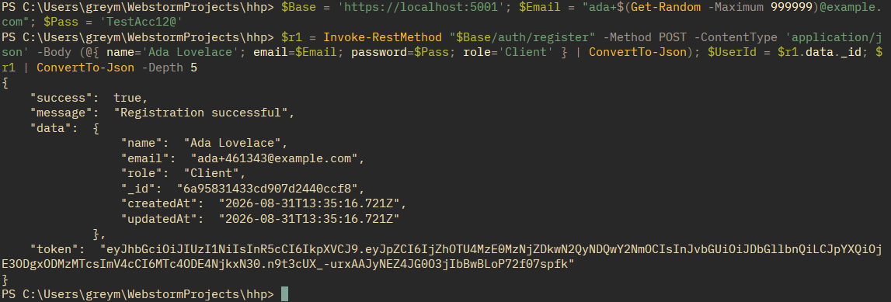

**2. Login works**
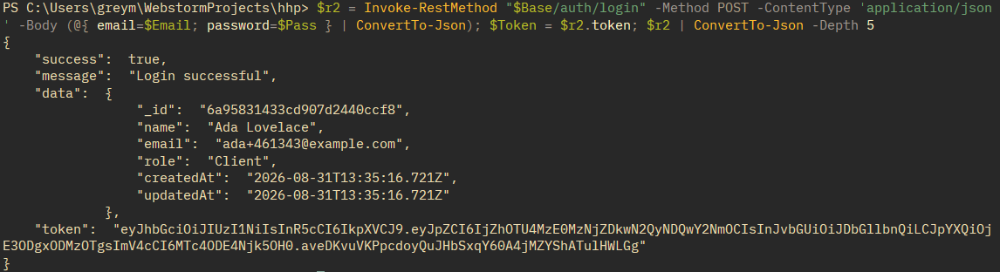

**3. The unique index works**
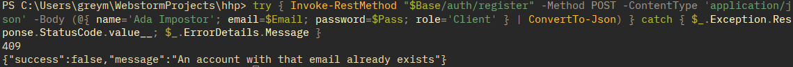

**4. One message for each login failure**
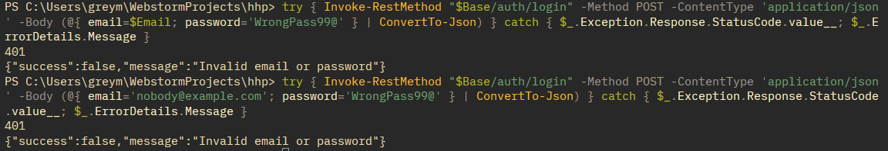

**5. Every bad field at once**
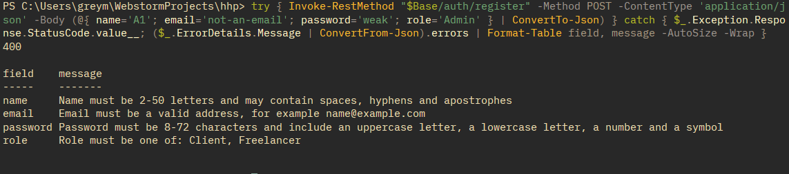

**6. A token is required**
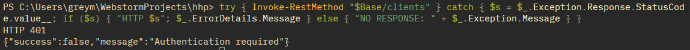

**7. The signature check works**
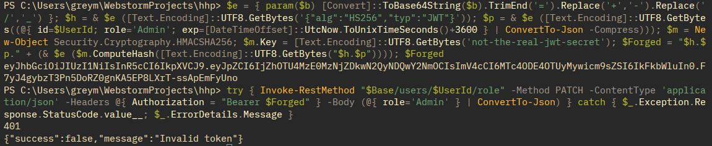

**8. No plain text password is stored**
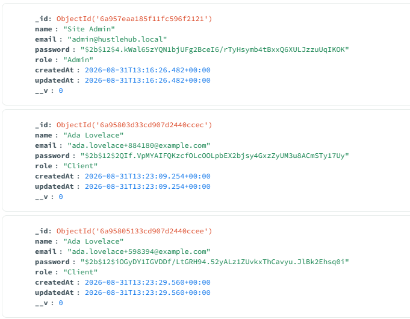

**9. The API uses TLS**
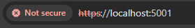

**10. The Part 1 suite passed**
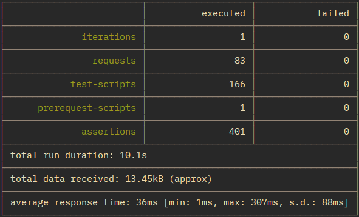

---

## 14. References

Apostrophe Technologies (n.d.) *sanitize-html*. Available at:
https://github.com/apostrophecms/apostrophe/tree/main/packages/sanitize-html
(Accessed: 10 October 2026).

Auth0 (n.d.) *node-jsonwebtoken*. Available at:
https://github.com/auth0/node-jsonwebtoken (Accessed: 10 October 2026).

Automattic (n.d. a) *Middleware*. Mongoose Documentation. Available at:
https://mongoosejs.com/docs/middleware.html (Accessed: 10 October 2026).

Automattic (n.d. b) *Mongoose: Mongoose.prototype.set()*. Mongoose API
Documentation. Available at:
https://mongoosejs.com/docs/api/mongoose.html#Mongoose.prototype.set()
(Accessed: 10 October 2026).

Automattic (n.d. c) *Populate*. Mongoose Documentation. Available at:
https://mongoosejs.com/docs/populate.html (Accessed: 10 October 2026).

Automattic (n.d. d) *Query*. Mongoose API Documentation. Available at:
https://mongoosejs.com/docs/api/query.html (Accessed: 10 October 2026).

Automattic (n.d. e) *Schemas*. Mongoose Documentation. Available at:
https://mongoosejs.com/docs/guide.html (Accessed: 10 October 2026).

Automattic (n.d. f) *Validation*. Mongoose Documentation. Available at:
https://mongoosejs.com/docs/validation.html (Accessed: 10 October 2026).

Fielding, R.T. (2000) *Architectural styles and the design of network-based
software architectures*. PhD thesis. University of California, Irvine.
Available at: https://ics.uci.edu/~fielding/pubs/dissertation/top.htm
(Accessed: 10 October 2026).

Fielding, R., Nottingham, M. and Reschke, J. (eds.) (2022) *HTTP semantics*.
RFC 9110. Internet Engineering Task Force. Available at:
https://www.rfc-editor.org/rfc/rfc9110.html (Accessed: 10 October 2026).

Friedly, N. (n.d.) *Configuration*. express-rate-limit Documentation.
Available at: https://express-rate-limit.mintlify.app/reference/configuration
(Accessed: 10 October 2026).

Grassi, P.A., Fenton, J.L., Newton, E.M., Perlner, R.A., Regenscheid, A.R.,
Burr, W.E. and Richer, J.P. (2017) *Digital identity guidelines: authentication
and lifecycle management*. NIST Special Publication 800-63B. Gaithersburg, MD:
National Institute of Standards and Technology. Available at:
https://pages.nist.gov/800-63-3/sp800-63b.html (Accessed: 10 October 2026).

Hahn, E. (n.d.) *Helmet*. Available at: https://helmet.js.org/ (Accessed:
10 October 2026).

Hodges, J., Jackson, C. and Barth, A. (2012) *HTTP strict transport security
(HSTS)*. RFC 6797. Internet Engineering Task Force. Available at:
https://www.rfc-editor.org/info/rfc6797/ (Accessed: 10 October 2026).

Ishaq, M.M., Singh, P., Badjatya, S., Kumar, S., Tomar, Y. and Bansal, S. (2023)
'Design and development of a user-friendly social media app using the MERN
stack', *2023 International Conference on Circuit Power and Computing
Technologies (ICCPCT)*. Kollam, India. IEEE, pp. 1730-1736.
doi: 10.1109/ICCPCT58313.2023.10245371.

Jones, M., Bradley, J. and Sakimura, N. (2015) *JSON web token (JWT)*. RFC 7519.
Internet Engineering Task Force. Available at:
https://datatracker.ietf.org/doc/html/rfc7519 (Accessed: 10 October 2026).

Jones, M. and Hardt, D. (2012) *The OAuth 2.0 authorization framework: bearer
token usage*. RFC 6750. Internet Engineering Task Force. Available at:
https://datatracker.ietf.org/doc/html/rfc6750 (Accessed: 10 October 2026).

Meta Platforms, Inc. (n.d.) *React*. Available at: https://react.dev/
(Accessed: 10 October 2026).

MITRE (2026a) *CWE-20: improper input validation*. Common Weakness Enumeration.
Available at: https://cwe.mitre.org/data/definitions/20.html (Accessed:
10 October 2026).

MITRE (2026b) *CWE-79: improper neutralization of input during web page
generation ('cross-site scripting')*. Common Weakness Enumeration. Available at:
https://cwe.mitre.org/data/definitions/79.html (Accessed: 10 October 2026).

MITRE (2026c) *CWE-204: observable response discrepancy*. Common Weakness
Enumeration. Available at: https://cwe.mitre.org/data/definitions/204.html
(Accessed: 10 October 2026).

MITRE (2026d) *CWE-209: generation of error message containing sensitive
information*. Common Weakness Enumeration. Available at:
https://cwe.mitre.org/data/definitions/209.html (Accessed: 10 October 2026).

MITRE (2026e) *CWE-532: insertion of sensitive information into log file*.
Common Weakness Enumeration. Available at:
https://cwe.mitre.org/data/definitions/532.html (Accessed: 10 October 2026).

MITRE (2026f) *CWE-639: authorization bypass through user-controlled key*.
Common Weakness Enumeration. Available at:
https://cwe.mitre.org/data/definitions/639.html (Accessed: 10 October 2026).

MITRE (2026g) *CWE-770: allocation of resources without limits or throttling*.
Common Weakness Enumeration. Available at:
https://cwe.mitre.org/data/definitions/770.html (Accessed: 10 October 2026).

MITRE (2026h) *CWE-798: use of hard-coded credentials*. Common Weakness
Enumeration. Available at: https://cwe.mitre.org/data/definitions/798.html
(Accessed: 10 October 2026).

MITRE (2026i) *CWE-915: improperly controlled modification of
dynamically-determined object attributes*. Common Weakness Enumeration.
Available at: https://cwe.mitre.org/data/definitions/915.html (Accessed:
10 October 2026).

MITRE (2026j) *CWE-943: improper neutralization of special elements in data
query logic*. Common Weakness Enumeration. Available at:
https://cwe.mitre.org/data/definitions/943.html (Accessed: 10 October 2026).

MongoDB, Inc. (n.d.) *MERN stack explained*. Available at:
https://www.mongodb.com/resources/languages/mern-stack (Accessed:
10 October 2026).

MongoDB, Inc. (2026a) *Partial indexes*. MongoDB Manual. Available at:
https://www.mongodb.com/docs/manual/core/index-partial/ (Accessed:
10 October 2026).

MongoDB, Inc. (2026b) *Query predicates*. MongoDB Manual. Available at:
https://www.mongodb.com/docs/manual/reference/mql/query-predicates/ (Accessed:
10 October 2026).

MongoDB, Inc. (2026c) *Transactions*. MongoDB Manual. Available at:
https://www.mongodb.com/docs/manual/core/transactions/ (Accessed:
10 October 2026).

Motte, S. (n.d.) *dotenv*. Available at: https://github.com/motdotla/dotenv
(Accessed: 10 October 2026).

Mozilla (n.d. a) *Content Security Policy (CSP)*. MDN Web Docs. Available at:
https://developer.mozilla.org/en-US/docs/Web/HTTP/Guides/CSP (Accessed:
10 October 2026).

Mozilla (n.d. b) *Cross-Origin Resource Sharing (CORS)*. MDN Web Docs.
Available at: https://developer.mozilla.org/en-US/docs/Web/HTTP/Guides/CORS
(Accessed: 10 October 2026).

Mozilla (n.d. c) *Cross-site scripting (XSS)*. MDN Web Docs. Available at:
https://developer.mozilla.org/en-US/docs/Web/Security/Attacks/XSS (Accessed:
10 October 2026).

Mozilla (n.d. d) *Strict-Transport-Security header*. MDN Web Docs. Available
at:
https://developer.mozilla.org/en-US/docs/Web/HTTP/Reference/Headers/Strict-Transport-Security
(Accessed: 10 October 2026).

Mozilla (n.d. e) *Transport Layer Security (TLS)*. MDN Web Docs. Available at:
https://developer.mozilla.org/en-US/docs/Web/Security/Defenses/Transport_Layer_Security
(Accessed: 10 October 2026).

Mozilla (n.d. f) *Window: sessionStorage property*. MDN Web Docs. Available at:
https://developer.mozilla.org/en-US/docs/Web/API/Window/sessionStorage
(Accessed: 10 October 2026).

National Institute of Standards and Technology (2026) *Role based access
control*. Computer Security Resource Center. Available at:
https://csrc.nist.gov/projects/role-based-access-control (Accessed:
10 October 2026).

OpenAPI Initiative (2024) *OpenAPI specification v3.1.1*. Available at:
https://spec.openapis.org/oas/v3.1.1.html (Accessed: 10 October 2026).

OpenJS Foundation (n.d. a) *About Node.js*. Available at:
https://nodejs.org/en/about (Accessed: 10 October 2026).

OpenJS Foundation (n.d. b) *cors*. Express.js Middleware. Available at:
https://expressjs.com/en/resources/middleware/cors.html (Accessed:
10 October 2026).

OpenJS Foundation (n.d. c) *Error handling*. Express.js Guide. Available at:
https://expressjs.com/en/guide/error-handling/ (Accessed: 10 October 2026).

OpenJS Foundation (n.d. d) *Express object*. Express 5.x API Reference.
Available at: https://expressjs.com/en/5x/api/express/ (Accessed:
10 October 2026).

OpenJS Foundation (n.d. e) *Getting started*. Jest Documentation. Available
at: https://jestjs.io/docs/getting-started (Accessed: 10 October 2026).

OpenJS Foundation (n.d. f) *HTTPS*. Node.js API Documentation. Available at:
https://nodejs.org/api/https.html (Accessed: 10 October 2026).

OpenJS Foundation (n.d. g) *Production best practices: performance and
reliability*. Express.js Guide. Available at:
https://expressjs.com/en/advanced/best-practice-performance/#set-node_env-to-production
(Accessed: 10 October 2026).

OpenJS Foundation (n.d. h) *Routing*. Express.js Guide. Available at:
https://expressjs.com/en/guide/routing/ (Accessed: 10 October 2026).

OpenJS Foundation (n.d. i) *TLS (SSL)*. Node.js API Documentation. Available
at: https://nodejs.org/api/tls.html (Accessed: 10 October 2026).

OpenJS Foundation (n.d. j) *Using middleware*. Express.js Guide. Available at:
https://expressjs.com/en/guide/using-middleware/ (Accessed: 10 October 2026).

OWASP (n.d. a) *Authentication cheat sheet*. OWASP Cheat Sheet Series.
Available at:
https://cheatsheetseries.owasp.org/cheatsheets/Authentication_Cheat_Sheet.html
(Accessed: 10 October 2026).

OWASP (n.d. b) *Authorization cheat sheet*. OWASP Cheat Sheet Series.
Available at:
https://cheatsheetseries.owasp.org/cheatsheets/Authorization_Cheat_Sheet.html
(Accessed: 10 October 2026).

OWASP (n.d. c) *Content security policy cheat sheet*. OWASP Cheat Sheet Series.
Available at:
https://cheatsheetseries.owasp.org/cheatsheets/Content_Security_Policy_Cheat_Sheet.html
(Accessed: 10 October 2026).

OWASP (n.d. d) *Cross site scripting prevention cheat sheet*. OWASP Cheat
Sheet Series. Available at:
https://cheatsheetseries.owasp.org/cheatsheets/Cross_Site_Scripting_Prevention_Cheat_Sheet.html
(Accessed: 10 October 2026).

OWASP (n.d. e) *Error handling cheat sheet*. OWASP Cheat Sheet Series.
Available at:
https://cheatsheetseries.owasp.org/cheatsheets/Error_Handling_Cheat_Sheet.html
(Accessed: 10 October 2026).

OWASP (n.d. f) *HTTP security response headers cheat sheet*. OWASP Cheat Sheet
Series. Available at:
https://cheatsheetseries.owasp.org/cheatsheets/HTTP_Headers_Cheat_Sheet.html
(Accessed: 10 October 2026).

OWASP (n.d. g) *Input validation cheat sheet*. OWASP Cheat Sheet Series.
Available at:
https://cheatsheetseries.owasp.org/cheatsheets/Input_Validation_Cheat_Sheet.html
(Accessed: 10 October 2026).

OWASP (n.d. h) *JSON web token cheat sheet*. OWASP Cheat Sheet Series.
Available at:
https://cheatsheetseries.owasp.org/cheatsheets/JSON_Web_Token_Cheat_Sheet.html
(Accessed: 10 October 2026).

OWASP (n.d. i) *Logging cheat sheet*. OWASP Cheat Sheet Series. Available at:
https://cheatsheetseries.owasp.org/cheatsheets/Logging_Cheat_Sheet.html
(Accessed: 10 October 2026).

OWASP (n.d. j) *Mass assignment cheat sheet*. OWASP Cheat Sheet Series.
Available at:
https://cheatsheetseries.owasp.org/cheatsheets/Mass_Assignment_Cheat_Sheet.html
(Accessed: 10 October 2026).

OWASP (n.d. k) *Password storage cheat sheet*. OWASP Cheat Sheet Series.
Available at:
https://cheatsheetseries.owasp.org/cheatsheets/Password_Storage_Cheat_Sheet.html
(Accessed: 10 October 2026).

OWASP (n.d. l) *Regular expression denial of service - ReDoS*. Available at:
https://community.owasp.org/attacks/Regular_expression_Denial_of_Service_-_ReDoS
(Accessed: 10 October 2026).

OWASP (2021a) *A01:2021 broken access control*. OWASP Top 10:2021. Available
at: https://top10.owasp.org/2021/A01_2021-Broken_Access_Control/ (Accessed:
10 October 2026).

OWASP (2021b) *A02:2021 cryptographic failures*. OWASP Top 10:2021. Available
at: https://top10.owasp.org/2021/A02_2021-Cryptographic_Failures/ (Accessed:
10 October 2026).

OWASP (2021c) *A03:2021 injection*. OWASP Top 10:2021. Available at:
https://top10.owasp.org/2021/A03_2021-Injection/ (Accessed: 10 October 2026).

OWASP (2021d) *A05:2021 security misconfiguration*. OWASP Top 10:2021.
Available at: https://top10.owasp.org/2021/A05_2021-Security_Misconfiguration/
(Accessed: 10 October 2026).

OWASP (2021e) *A09:2021 security logging and monitoring failures*. OWASP Top
10:2021. Available at:
https://top10.owasp.org/2021/A09_2021-Security_Logging_and_Monitoring_Failures/
(Accessed: 10 October 2026).

OWASP (2023a) *API1:2023 broken object level authorization*. OWASP API
Security Top 10, 2023 edition. Available at:
https://api-security.owasp.org/editions/2023/en/0xa1-broken-object-level-authorization/
(Accessed: 10 October 2026).

OWASP (2023b) *API3:2023 broken object property level authorization*. OWASP
API Security Top 10, 2023 edition. Available at:
https://api-security.owasp.org/editions/2023/en/0xa3-broken-object-property-level-authorization/
(Accessed: 10 October 2026).

OWASP (2023c) *API4:2023 unrestricted resource consumption*. OWASP API
Security Top 10, 2023 edition. Available at:
https://api-security.owasp.org/editions/2023/en/0xa4-unrestricted-resource-consumption/
(Accessed: 10 October 2026).

OWASP (2023d) *API5:2023 broken function level authorization*. OWASP API
Security Top 10, 2023 edition. Available at:
https://api-security.owasp.org/editions/2023/en/0xa5-broken-function-level-authorization/
(Accessed: 10 October 2026).

Parnas, D.L. (1972) 'On the criteria to be used in decomposing systems into
modules', *Communications of the ACM*, 15(12), pp. 1053-1058.
doi: 10.1145/361598.361623.

Postman, Inc. (n.d. a) *Collections overview*. Postman Learning Center.
Available at: https://learning.postman.com/docs/use/use-collections/overview/
(Accessed: 10 October 2026).

Postman, Inc. (n.d. b) *Run and test collections from the command line using
Newman CLI*. Postman Learning Center. Available at:
https://learning.postman.com/docs/reference/newman-cli/command-line-integration-with-newman/
(Accessed: 10 October 2026).

Postman, Inc. (n.d. c) *Write scripts to test API response data in Postman*.
Postman Learning Center. Available at:
https://learning.postman.com/docs/tests-and-scripts/write-scripts/test-scripts/
(Accessed: 10 October 2026).

Provos, N. and Mazières, D. (1999) 'A future-adaptable password scheme',
*Proceedings of the FREENIX Track: 1999 USENIX Annual Technical Conference*.
Monterey, CA. USENIX Association, pp. 81-91. Available at:
https://www.usenix.org/legacy/events/usenix99/provos/provos.pdf (Accessed:
10 October 2026).

Rescorla, E. (2018) *The transport layer security (TLS) protocol version 1.3*.
RFC 8446. Internet Engineering Task Force. Available at:
https://www.rfc-editor.org/info/rfc8446/ (Accessed: 10 October 2026).

Romaniello, J.F. (n.d.) *selfsigned*. Available at:
https://github.com/jfromaniello/selfsigned (Accessed: 10 October 2026).

Scalar (n.d.) *API References for Express*. Available at:
https://scalar.com/products/api-references/integrations/express (Accessed:
10 October 2026).

shadcn (n.d.) *shadcn/ui documentation*. Available at: https://ui.shadcn.com/docs
(Accessed: 10 October 2026).

Sheffer, Y., Hardt, D. and Jones, M. (2020) *JSON web token best current
practices*. RFC 8725. Internet Engineering Task Force. Available at:
https://datatracker.ietf.org/doc/html/rfc8725 (Accessed: 10 October 2026).

Shopify, Inc. (n.d.) *React Router*. Available at: https://reactrouter.com/home
(Accessed: 10 October 2026).

Testing Library (n.d.) *React Testing Library: introduction*. Available at:
https://testing-library.com/docs/react-testing-library/intro/ (Accessed:
10 October 2026).

Vite Team (n.d.) *Server options*. Vite Documentation. Available at:
https://vite.dev/config/server-options (Accessed: 10 October 2026).

Vitest Team (n.d.) *Getting started*. Vitest Documentation. Available at:
https://vitest.dev/guide/ (Accessed: 10 October 2026).

Wiggins, A. (2017) *III. Config*. The Twelve-Factor App. Available at:
https://12factor.net/config (Accessed: 10 October 2026).

Wirtz, D. (n.d.) *bcrypt.js*. Available at: https://github.com/dcodeIO/bcrypt.js
(Accessed: 10 October 2026).

---

**HustleHub+** | INSY7314 | Information Systems 3D | Portfolio of Evidence | Part 2
